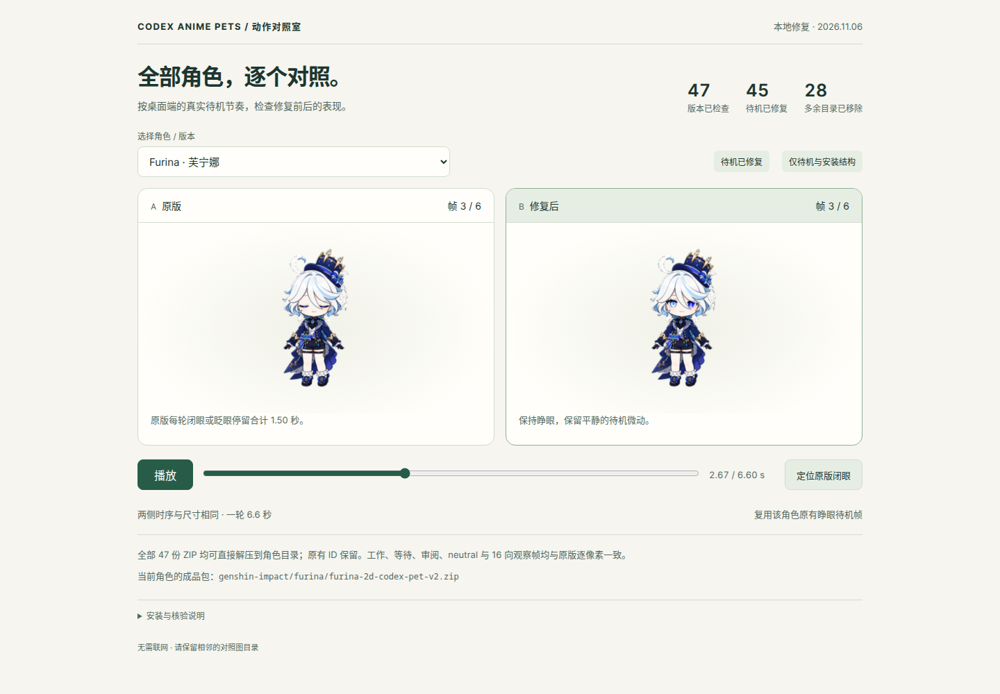

# Desktop pet compatibility · 2026-11-06

All 47 editions are updated. 45 idle animations avoid prolonged closed-eye holds in the tested desktop client; Venti and Ellen retain their original idle artwork. All 47 ZIPs now contain `pet.json`, `spritesheet.webp`, and `README.md` directly at the archive root, removing the extra directory from 28 archives. IDs and manifest bytes are preserved.

Download or clone this branch, then open [the comparison HTML](pet-idle-comparison.html) in a browser. Keep its adjacent `pet-idle-comparison-assets/` directory. It includes all 47 editions, synchronized playback and an original-blink inspection button. No network connection is needed.

## Scope and evidence

- Tested idle timing: `[1680, 660, 660, 840, 840, 1920]` ms, one 6.6-second loop, from desktop client `26.1007.21434`. Future client versions may change their timing.
- 41 editions reuse their own original open-eye idle frames; no new artwork or cross-state frame reuse.
- Raiden Mei 3D uses a fresh deterministic extraction of its complete original coherent idle strip, fixing visibly truncated hair from equal-width cropping.
- Xiao, Dan Heng · Imbibitor Lunae and Jing Yuan use their previously reviewed six-frame idle candidates.
- All 82 cells outside the six idle slots are pixel-identical to the baseline in every edition, including neutral and all 16 look directions.
- 47/47 atlas validations and independent visual reviews passed. All 47 archives were extracted and matched against their release directories; 16 existing checksum files were refreshed.
- The comparison passed 105 browser checks, including every edition, mobile layout, keyboard controls, reduced motion and standalone offline loading. Final release files passed 378 integrity checks.
- All 47 README idle previews use the final atlas and 6.6-second timing. Visible RGBA pixels and alpha were checked losslessly.
- Accepted minor detail: Raiden Mei 3D retains tiny hair-tip endpoint details where neighboring tips meet in the original source. They do not affect the native-size silhouette.

[Machine-readable hashes and coverage](pet-compatibility-validation.json). Baseline: [0a7cb6d](https://github.com/TiantianTitan/codex-anime-pets/commit/0a7cb6dea9bdbcc476843bf3f07892f6b47acaa1).

## Editions

| ID | Idle update | ZIP |
| --- | --- | --- |
| `tartaglia` | Own original idle frames | [Download](../genshin-impact/Tartaglia/tartaglia-2d-codex-pet-v2.zip) |
| `venti` | Original idle preserved | [Download](../genshin-impact/Venti/venti-2d-codex-pet-v2.zip) |
| `wanderer` | Own original idle frames | [Download](../genshin-impact/Wanderer/wanderer-2d-codex-pet-v2.zip) |
| `furina` | Own original idle frames | [Download](../genshin-impact/furina/furina-2d-codex-pet-v2.zip) |
| `ganyu` | Own original idle frames | [Download](../genshin-impact/ganyu/ganyu-2d-codex-pet-v2.zip) |
| `hu-tao` | Own original idle frames | [Download](../genshin-impact/hu-tao/hu-tao-2d-codex-pet-v2.zip) |
| `kazuha-chibi` | Own original idle frames | [Download](../genshin-impact/kaedehara-kazuha/kazuha-chibi-2d-codex-pet-v2.zip) |
| `kaeya` | Own original idle frames | [Download](../genshin-impact/kaeya/kaeya-2d-codex-pet-v2.zip) |
| `kamisato-ayaka` | Own original idle frames | [Download](../genshin-impact/kamisato-ayaka/kamisato-ayaka-2d-codex-pet-v2.zip) |
| `raiden-shogun` | Own original idle frames | [Download](../genshin-impact/raiden-shogun/raiden-shogun-2d-codex-pet-v2.zip) |
| `xiao` | Reviewed idle artwork | [Download](../genshin-impact/xiao/xiao-2d.zip) |
| `yae-miko` | Own original idle frames | [Download](../genshin-impact/yae-miko/yae-miko-2d-codex-pet-v2.zip) |
| `zhongli` | Own original idle frames | [Download](../genshin-impact/zhongli/zhongli-2d-codex-pet-v2.zip) |
| `black-swan` | Own original idle frames | [Download](../honkai-star-rail/Black%20Swan/black-swan-2d-codex-pet-v2.zip) |
| `kafka` | Own original idle frames | [Download](../honkai-star-rail/Kafka/kafka-2d-codex-pet-v2.zip) |
| `sparkle` | Own original idle frames | [Download](../honkai-star-rail/Sparkle/sparkle-2d-codex-pet-v2.zip) |
| `acheron` | Own original idle frames | [Download](../honkai-star-rail/acheron/acheron-2d-codex-pet-v2.zip) |
| `aventurine` | Own original idle frames | [Download](../honkai-star-rail/aventurine/aventurine-2d-codex-pet-v2.zip) |
| `blade` | Own original idle frames | [Download](../honkai-star-rail/blade/blade-2d-codex-pet-v2.zip) |
| `dan-heng-imbibitor-lunae` | Reviewed idle artwork | [Download](../honkai-star-rail/dan-heng-imbibitor-lunae/dan-heng-imbibitor-lunae-2d-codex-pet-v2.zip) |
| `firefly` | Own original idle frames | [Download](../honkai-star-rail/firefly/firefly-2d-codex-pet-v2.zip) |
| `jing-yuan` | Reviewed idle artwork | [Download](../honkai-star-rail/jing-yuan/jing-yuan-2d-codex-pet-v2.zip) |
| `robin` | Own original idle frames | [Download](../honkai-star-rail/robin/robin-2d-codex-pet-v2.zip) |
| `ruan-mei` | Own original idle frames | [Download](../honkai-star-rail/ruan-mei/ruan-mei-2d-codex-pet-v2.zip) |
| `sunday` | Own original idle frames | [Download](../honkai-star-rail/sunday/sunday-2d-codex-pet-v2.zip) |
| `bronya-zaychik` | Own original idle frames | [Download](../honkai-impact-3rd/Bronya%20Zaychik/bronya-zaychik-2d-codex-pet-v2.zip) |
| `fu-hua` | Own original idle frames | [Download](../honkai-impact-3rd/Fu%20Hua/fu-hua-2d-codex-pet-v2.zip) |
| `kiana-kaslana` | Own original idle frames | [Download](../honkai-impact-3rd/Kiana%20Kaslana/kiana-kaslana-2d-codex-pet-v2.zip) |
| `otto-apocalypse` | Own original idle frames | [Download](../honkai-impact-3rd/Otto-Apocalypse/otto-apocalypse-2d-codex-pet-v2.zip) |
| `seele-vollerei` | Own original idle frames | [Download](../honkai-impact-3rd/Seele%20Vollerei/seele-vollerei-2d-codex-pet-v2.zip) |
| `theresa` | Own original idle frames | [Download](../honkai-impact-3rd/Theresa/theresa-2d-codex-pet-v2.zip) |
| `kevin-kaslana` | Own original idle frames | [Download](../honkai-impact-3rd/kevin-kaslana/kevin-kaslana-2d-codex-pet-v2.zip) |
| `raiden-mei` | Own original idle frames | [Download](../honkai-impact-3rd/raiden-mei/raiden-mei-2d-codex-pet-v2.zip) |
| `raiden-mei-3d` | Original source re-extraction | [Download](../honkai-impact-3rd/raiden-mei/raiden-mei-3d-codex-pet-v2.zip) |
| `burnice-white` | Own original idle frames | [Download](../zenless-zone-zero/Burnice%20White/burnice-white-2d-codex-pet-v2.zip) |
| `lighter` | Own original idle frames | [Download](../zenless-zone-zero/Lighter/lighter-2d-codex-pet-v2.zip) |
| `vivian-banshee` | Own original idle frames | [Download](../zenless-zone-zero/Vivian%20Banshee/vivian-banshee-2d-codex-pet-v2.zip) |
| `von-lycaon` | Own original idle frames | [Download](../zenless-zone-zero/Von%20Lycaon/von-lycaon-2d-codex-pet-v2.zip) |
| `zhu-yuan` | Own original idle frames | [Download](../zenless-zone-zero/Zhu%20Yuan/zhu-yuan-2d-codex-pet-v2.zip) |
| `anby-demara` | Own original idle frames | [Download](../zenless-zone-zero/anby-demara/anby-demara-2d-codex-pet-v2.zip) |
| `ellen-joe` | Original idle preserved | [Download](../zenless-zone-zero/ellen-joe/ellen-joe-2d-codex-pet-v2.zip) |
| `miyabi` | Own original idle frames | [Download](../zenless-zone-zero/hoshimi-miyabi/miyabi-2d-codex-pet-v2.zip) |
| `jane-doe` | Own original idle frames | [Download](../zenless-zone-zero/jane-doe/jane-doe-2d-codex-pet-v2.zip) |
| `nicole-demara` | Own original idle frames | [Download](../zenless-zone-zero/nicole-demara/nicole-demara-2d-codex-pet-v2.zip) |
| `kibutsuji-muzan` | Own original idle frames | [Download](../others/Kibutsuji%20Muzan/kibutsuji-muzan-2d-codex-pet-v2.zip) |
| `mitsuri-kanroji` | Own original idle frames | [Download](../others/mitsuri-kanroji/mitsuri-kanroji-2d-codex-pet-v2.zip) |
| `obanai` | Own original idle frames | [Download](../others/obanai-iguro/obanai-2d-codex-pet-v2.zip) |
